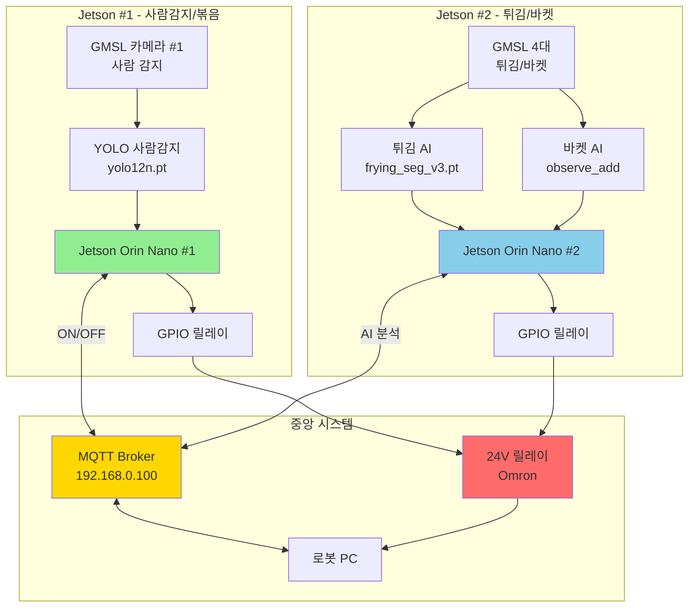

# AI 기능 상세 운영 보고서 (전체 구현 기능)

**작성일**: 2026-02-02
**문서 버전**: 2.0 (상세 확장판)

본 문서는 Jetson Orin Nano 기반 식당 모니터링 시스템에 **실제 구현된 모든 기능**을 상세히 기술합니다.

**📊 다이어그램**: 시스템의 주요 다이어그램은 [SYSTEM_DIAGRAMS.md](./SYSTEM_DIAGRAMS.md)를 참조하세요.

---

## 목차

1. [시스템 아키텍처](#1-시스템-아키텍처)
2. [Jetson #1 구현 기능 (60개 메서드)](#2-jetson-1-구현-기능)
3. [Jetson #2 구현 기능 (75개 메서드)](#3-jetson-2-구현-기능)
4. [MQTT 통신 프로토콜](#4-mqtt-통신-프로토콜)
5. [데이터 저장 구조](#5-데이터-저장-구조)
6. [설정 파라미터 상세](#6-설정-파라미터-상세)
7. [성능 최적화](#7-성능-최적화)
8. [트러블슈팅 가이드](#8-트러블슈팅-가이드)

---

## 1. 시스템 아키텍처

> **📊 전체 시스템 아키텍처 다이어그램**: [SYSTEM_DIAGRAMS.md - 섹션 1](./SYSTEM_DIAGRAMS.md#1-전체-시스템-아키텍처)

### 1.1 하드웨어 구성

| 항목 | Jetson #1 | Jetson #2 |
|------|-----------|-----------|
| **모델** | NVIDIA Orin Nano | NVIDIA Orin Nano |
| **카메라** | GMSL 3대 | GMSL 4대 |
| **용도** | 사람감지 1대<br>볶음 좌/우 2대 | 튀김 좌/우 2대<br>바켓 좌/우 2대 |
| **해상도** | 1920x1536 @ 30fps | 1920x1536 @ 30fps |
| **GPIO** | Pin 29, 31 (릴레이) | Pin 29, 31 (릴레이) |
| **진동센서** | CH340 USB-RS485 | CH340 USB-RS485 |
| **디스플레이** | 768x1024 (세로) | 768x1024 (세로) |

### 1.2 소프트웨어 스택

```
┌─────────────────────────────────────────┐
│  tkinter GUI (768x1024 세로 모드)       │
├─────────────────────────────────────────┤
│  YOLO (ultralytics)  │  PyTorch CUDA    │
├─────────────────────────────────────────┤
│  MQTT (paho-mqtt)    │  GStreamer       │
├─────────────────────────────────────────┤
│  GPIO (JetsonGPIO)   │  Modbus (RS485)  │
├─────────────────────────────────────────┤
│  Ubuntu 20.04 + JetPack 6.2             │
└─────────────────────────────────────────┘
```

### 1.3 전체 시스템 다이어그램



---

## 2. Jetson #1 구현 기능

> **📊 주야간 상태 머신 다이어그램**: [SYSTEM_DIAGRAMS.md - 섹션 3](./SYSTEM_DIAGRAMS.md#3-주야간-모드-상태-머신-jetson-1)

**메인 클래스**: `IntegratedMonitorApp` (4,034줄)
**설정 파일**: `jetson1_monitoring/config.json`
**총 메서드**: 약 60개

### 2.1 사람 감지 시스템

#### 2.1.1 YOLO 기반 실시간 감지
- **모델**: `yolo12n.pt` (nano 버전, GPU 가속)
- **입력 크기**: 416x416 (설정 가능)
- **신뢰도**: 0.7 (조정 가능)
- **주요 메서드**:
  - `init_yolo()`: YOLO 모델 GPU 로딩
  - `process_day_mode(frame, now)`: 주간 사람 감지 처리
  - `update_auto_system()`: 실시간 프레임 처리 루프

#### 2.1.2 감지 조건 및 홀드 타임
```python
# config.json 설정
"detection_hold_sec": 2  # 2초 이상 지속 감지 시 ON
```
- 순간 감지가 아닌 **지속 감지** 기반
- 오감지 방지용 누적 시간 체크
- 화면에 실시간 감지 상태 표시

#### 2.1.3 주야간 자동 전환
- **주간 시간**: 04:00 ~ 21:00
- **야간 시간**: 21:00 ~ 04:00
- **모드 설정**: `auto` (자동), `day` (항상 주간), `night` (항상 야간)
- **주요 메서드**:
  - `is_daytime_mode(now)`: 현재 시간대 판단
  - 시간 전환 시 자동으로 릴레이 제어

### 2.2 야간 감시 시스템

#### 2.2.1 야간 미감지 확인
```python
# config.json 설정
"night_check_minutes": 0  # 0=즉시, N=N분 후 OFF
```
- 야간 모드 진입 후 N분간 사람 미감지 시 **OFF 신호**
- 주기적 OFF 펄스로 상시전원 유지

#### 2.2.2 모션 감지 스냅샷
- **알고리즘**: MOG2 (Background Subtraction)
- **설정**:
  ```python
  "motion_min_area": 2500         # 모션 최소 면적 (픽셀)
  "mog2_varthresh": 24            # 배경차분 임계값 (낮을수록 민감)
  "binary_thresh": 220            # 이진화 임계값 (높을수록 덜 민감)
  "snapshot_cooldown_sec": 15     # 저장 간격 (초)
  ```
- **저장 경로**: `~/Detection/YYYYMMDD/HHMMSS.jpg`
- **주요 메서드**:
  - `process_night_mode(frame, now)`: 야간 모션 감지
  - `save_snapshot(frame, timestamp)`: 스냅샷 저장

#### 2.2.3 야간 감지 리뷰 (Night Review)
```python
# config.json 설정
"night_review_enabled": true
"night_review_time": "08:00"          # 아침 8시 자동 리뷰
"night_review_duration_min": 10       # 10분간 표시
"night_review_auto_archive": true     # 확인 후 자동 아카이브
```
- **기능**: 야간에 저장된 스냅샷을 아침에 자동 팝업으로 리뷰
- **동작**: 설정 시간에 자동으로 야간 스냅샷 갤러리 표시
- **주요 메서드**: `show_night_review()`

### 2.3 릴레이 제어 시스템

#### 2.3.1 하드웨어 구성
- **릴레이**: 24V Omron 자기유지형 릴레이
- **드라이버**: ULN2803 (Darlington Array)
- **GPIO**: Pin 29 (GPIO07) + Pin 31 (GPIO416) **동시 사용**
- **제어 방식**: Pulse 모드 (200ms HIGH → LOW)

#### 2.3.2 릴레이 제어 모드
```python
# config.json 설정
"relay_mode": "pulse"              # pulse 또는 continuous
"auto_relay_enabled": true         # 자동 제어 활성화
"periodic_off_pulse_enabled": true # 주기적 OFF 펄스
"periodic_off_pulse_interval_min": 0.05  # 3초마다 OFF 펄스
```

| 모드 | 설명 | 용도 |
|------|------|------|
| **pulse** | 200ms HIGH → LOW | 자기유지 릴레이 (Omron) |
| **continuous** | 계속 HIGH 유지 | 일반 릴레이 |

#### 2.3.3 주요 메서드
- `relay_turn_on(publish_to_jetson2=True)`: ON 펄스 전송 + MQTT 발행
- `relay_turn_off()`: OFF 펄스 전송
- `send_off_pulse(now)`: 단일 OFF 펄스
- `check_periodic_off_pulse(now)`: 주기적 OFF 펄스 (브로커 PC 상시전원용)

#### 2.3.4 Jetson #2 종료 대기
```python
"jetson2_shutdown_delay_sec": 3  # Jetson #2 OFF 후 3초 대기
```
- Jetson #1이 OFF 신호 시, Jetson #2에 먼저 알림
- 3초 대기 후 Jetson #1 릴레이 OFF
- 안전한 종료 보장

### 2.4 볶음 모니터링 시스템

#### 2.4.1 카메라 구성
- **좌측**: GMSL video0
- **우측**: GMSL video1
- **해상도**: 1920x1536 @ 30fps

#### 2.4.2 데이터 수집
```python
# config.json 설정
"stirfry_save_enabled": false         # 데이터 수집 활성화
"stirfry_save_dir": "AI_Data/StirFryData"
"stirfry_jpeg_quality": 100           # 최고 품질
"stirfry_frame_skip": 90              # 3초마다 저장 (30fps)
"recording_delay_after_discharge": 20 # 배출 후 20초 추가 녹화
```

#### 2.4.3 MQTT 기반 녹화 제어
- **구독 토픽**:
  - `stirfry/pot1/food_type`: 음식 종류 수신
  - `stirfry/pot1/control`: `투입/배출` 신호
  - `stirfry/pot2/food_type`
  - `stirfry/pot2/control`

- **동작 흐름**:
  1. `투입` 신호 수신 → 녹화 시작
  2. `배출` 신호 수신 → 20초 추가 녹화 후 종료
  3. 데이터 저장: `~/AI_Data/StirFryData/YYYYMMDD_HHMMSS_chicken_pot1/`

- **주요 메서드**:
  - `on_stirfry_pot1_food_type()`: 음식 종류 수신
  - `on_stirfry_pot1_control()`: 투입/배출 신호 처리
  - `start_stirfry_pot1_recording()`: 녹화 시작
  - `stop_stirfry_pot1_recording()`: 녹화 종료
  - `_delayed_stop_pot1_recording()`: 20초 지연 종료

#### 2.4.4 저장 구조
```
~/AI_Data/StirFryData/
└── 20260202_143055_chicken_pot1/
    ├── left_000001.jpg  (1920x1536, 100% quality)
    ├── left_000002.jpg
    ├── ...
    ├── right_000001.jpg
    ├── right_000002.jpg
    └── session_info.json
```

### 2.5 사람 감지 데이터 수집 (로봇회사 요청)

#### 2.5.1 스케줄 기반 자동 수집
```python
# config.json 설정
"person_data_collection_enabled": true
"person_collection_start_time": "08:30"  # 아침 8시 30분 시작
"person_collection_end_time": "12:00"    # 낮 12시 종료
"person_collection_interval_sec": 5      # 5초마다 촬영
"person_collection_save_dir": "AI_Data/PersonData"
```

#### 2.5.2 평일 자동 동작
- **동작**: 월~금 평일만 자동 수집
- **주말**: 수집 안 함
- **주요 메서드**:
  - `is_weekday()`: 평일 체크
  - `is_person_collection_time()`: 수집 시간대 체크
  - `check_person_collection_schedule()`: 스케줄러
  - `capture_person_frame()`: 프레임 저장

#### 2.5.3 저장 형식
```
~/AI_Data/PersonData/
└── 20260202/
    ├── 083005.jpg  (640x512, 50% quality)
    ├── 083010.jpg
    └── ...
```

### 2.6 진동센서 통합 (WitMotion JY901B)

#### 2.6.1 하드웨어 연결
- **센서**: WitMotion JY901B (9축 IMU)
- **통신**: CH340 USB-RS485 → `/dev/ttyUSB0`
- **프로토콜**: Modbus RTU
- **라이브러리**: pymodbus 3.x

#### 2.6.2 MQTT 제어
- **구독 토픽**: `stirfry/pot{N}/control`
- **VibrationRequest 메시지**:
  ```json
  {
    "command": "VibrationRequest",
    "pot": 1,
    "action": "measure"
  }
  ```

#### 2.6.3 측정 및 응답
- **측정 시간**: 약 5초 (설정 가능)
- **임계값**: `vibration_config.json`에서 로드
- **응답 메시지**:
  ```json
  {
    "device_id": "jetson1",
    "vibration_status": "NORMAL",  // 또는 "ABNORMAL"
    "vel_mag_max": 0.0234,
    "threshold": 0.05
  }
  ```

#### 2.6.4 테스트 모드
```python
"vibration_test_mode": false  # true=즉시 NORMAL 응답 (실제 측정 안 함)
```

- **주요 메서드**:
  - `on_vibration_control()`: MQTT 요청 수신
  - `start_vibration_check()`: 측정 시작
  - `stop_vibration_check()`: 측정 중단
  - `_update_vibration_result()`: 결과 처리

### 2.7 MQTT 통신

#### 2.7.1 발행 토픽 (Jetson #1 → Robot PC)
| 토픽 | 내용 | QoS | 주기 |
|------|------|-----|------|
| `robot/control` | `ON` / `OFF` 신호 | 1 | 이벤트 |
| `jetson1/relay/status` | `ON` / `OFF` 상태 | 1 | 이벤트 |
| `jetson1/system/ai_mode` | AI 모드 상태 | 1 | 2초 |

#### 2.7.2 구독 토픽 (Robot PC → Jetson #1)
| 토픽 | 내용 | 처리 |
|------|------|------|
| `stirfry/pot1/food_type` | 음식 종류 | 녹화 준비 |
| `stirfry/pot1/control` | 투입/배출 | 녹화 시작/종료 |
| `stirfry/pot2/food_type` | 음식 종류 | 녹화 준비 |
| `stirfry/pot2/control` | 투입/배출 | 녹화 시작/종료 |
| `HR/Status` | 로봇 상태 | 상태 모니터링 |

#### 2.7.3 주요 메서드
- `init_mqtt()`: MQTT 클라이언트 초기화
- `publish_relay_status(status)`: 릴레이 상태 발행
- `publish_mqtt(message)`: `robot/control` 메시지 발행
- `publish_mqtt_periodic()`: 주기적 상태 발행
- `send_mqtt_message(topic, message)`: 범용 MQTT 발행

### 2.8 GUI 시스템

#### 2.8.1 디스플레이 모드
```python
# config.json 설정
"display_window": false          # GUI 활성화
"window_width": 768
"window_height": 1024
"fullscreen": true               # 전체화면
"window_decorations": true       # 창 테두리
```

#### 2.8.2 화면 구성
```
┌─────────────────────────────────┐
│  시계 + 상태 표시               │  ← 상단바
├─────────────────────────────────┤
│  [사람 감지 카메라]             │
│  상태: 감지중 / 대기중          │  ← Auto Panel
│  릴레이: ON / OFF               │
├─────────────────────────────────┤
│  [볶음 좌측]  │  [볶음 우측]   │  ← Stirfry Panels
│  녹화: 진행중 │  녹화: 대기    │
├─────────────────────────────────┤
│ [설정] [MQTT] [진동] [종료]    │  ← Control Bar
└─────────────────────────────────┘
```

#### 2.8.3 주요 GUI 메서드
- `create_gui()`: 전체 GUI 생성
- `create_auto_panel()`: 사람 감지 패널
- `create_stirfry_left_panel()`: 볶음 좌측 패널
- `create_stirfry_right_panel()`: 볶음 우측 패널
- `create_bottom_control_bar()`: 하단 컨트롤 바
- `update_clock()`: 시계 업데이트 (1초마다)
- `show_toast(message)`: 토스트 메시지

#### 2.8.4 프리뷰 자동 숨김
```python
"preview_hide_delay": 999999  # 999999=항상 표시
```
- 설정 시간 후 프리뷰 자동 숨김 (공간 절약)

### 2.9 개발자 모드 (Dev Panel)

#### 2.9.1 기능
- **접근**: GUI에서 개발자 모드 토글
- **주요 기능**:
  - 수동 릴레이 ON/OFF
  - 강제 스냅샷 모드
  - 야간 리뷰 수동 실행
  - 시스템 로그 뷰어
  - MQTT 상태 모니터링

#### 2.9.2 주요 메서드
- `toggle_developer_mode()`: 개발자 모드 토글
- `force_snapshot_mode()`: 강제 스냅샷
- `show_system_logs()`: 로그 뷰어 팝업
- `show_mqtt_status_popup()`: MQTT 상태 팝업

### 2.10 로그 및 모니터링

#### 2.10.1 시스템 로그 뷰어
- **기능**: systemctl 로그 실시간 표시
- **명령어**: `journalctl -u jetson1-monitor -n 500 --no-pager`
- **GUI**: 스크롤 가능한 텍스트 창
- **주요 메서드**: `show_system_logs()`

#### 2.10.2 MQTT 메시지 로그
- **기능**: 송수신 메시지 실시간 로깅
- **저장**: 메모리 (최근 100개)
- **표시**: 시간, 방향, 토픽, 페이로드
- **주요 메서드**: `_log_mqtt_message(topic, payload)`

### 2.11 설정 관리

#### 2.11.1 설정 파일 로드
- **파일**: `config.json`
- **로드**: 프로그램 시작 시 자동
- **기본값**: 하드코딩된 기본값 사용
- **주요 함수**: `load_config(config_path)`

#### 2.11.2 실행 중 설정 변경
- GUI에서 일부 설정 변경 가능 (예: 릴레이 모드)
- 변경 사항은 재시작 시 초기화 (config.json 수정 필요)

---

## 3. Jetson #2 구현 기능

**메인 클래스**: `JetsonIntegratedApp` (4,477줄)
**설정 파일**: `jetson2_frying_ai/config_jetson2.json`
**총 메서드**: 약 75개

### 3.1 튀김 AI 시스템 (Frying AI)

> **📊 튀김 AI 처리 파이프라인**: [SYSTEM_DIAGRAMS.md - 섹션 4](./SYSTEM_DIAGRAMS.md#4-튀김-ai-처리-파이프라인-jetson-2)

#### 3.1.1 모델 구성
- **세그멘테이션 모델**: `frying_seg_v3.pt` (YOLOv8-seg)
- **분류 모델**: `frying_cls.pt` (상태 분류)
- **입력 크기**: `[800, 540]` (letterbox)
- **신뢰도**: 0.05 (매우 낮음, 작은 객체도 감지)

#### 3.1.2 v3 모델 특징 (2026-02-02 학습)
```python
# config_jetson2.json 설정
"frying_seg_model": "frying_seg_v3.pt"
"_comment_frying_seg_model": "v3: 800x540 resolution (mAP@50: 67.8%), trained 2026-02-02"
"frying_seg_imgsz": [800, 540]
"frying_seg_conf": 0.05
"frying_seg_mask_thresh": 0.2
```

- **해상도**: 800x540 (학습 시 imgsz=800)
- **mAP@50**: 67.8%
- **프레임 처리**: 1920x1536 원본 → YOLO 내부 letterbox → 추론

#### 3.1.3 Lift Tracking (탈탈 이벤트 추적)
```python
# config_jetson2.json 설정
"lift_area_threshold": 0.15      # 튀김 보이는 비율 (15% 증가 시 탈탈)
"lift_cooldown_sec": 2.0         # 탈탈 간격 (2초)
"color_change_threshold": 12.0   # 완료 판단 색변화 (델타 E)
```

- **알고리즘**:
  1. YOLO 마스크에서 음식 영역 계산
  2. 이전 프레임 대비 면적 15% 증가 → "탈탈 이벤트" 감지
  3. 탈탈 이벤트마다 색상 특징 추출 (LAB 색공간)
  4. 델타 E > 12 → "완료" 판단

- **외부 모듈**: `lift_event_tracker.py` (LiftTracker 클래스)

#### 3.1.4 주요 메서드
- `update_frying_left()`: 튀김 좌측 프레임 처리
- `update_frying_right()`: 튀김 우측 프레임 처리
- `_frying_poll_worker()`: 추론 결과 폴링
- `_should_run_frying_infer()`: 추론 실행 조건 체크
- `schedule_taltal_capture()`: 탈탈 이벤트 시 캡처 예약
- `capture_taltal_frame()`: 탈탈 프레임 저장

#### 3.1.5 DISCHARGE 판정 로직
- **조건**:
  1. Lift Tracker가 "완료" 판정
  2. 로봇 PC 상태: `운전시간 >= 목표시간 - 5초`
  3. 온도: `probe_temp >= target_temp - 5°C`

- **동작**:
  - `COOKING` → `DISCHARGE` 상태 전환
  - MQTT로 `DISCHARGE` 발행
  - 로봇 PC가 배출 동작 시작

### 3.2 바켓 감지 (Observe_add)

#### 3.2.1 모델 구성
- **좌측 세그멘테이션**: `observe_add/best_io.pt`
- **좌측 분류**: `observe_add/best_fe.pt`
- **우측**: 좌측 모델 공유 (설정 가능)

#### 3.2.2 감지 로직
```python
# 설정
"observe_enabled": true
"observe_left_enabled": true
"observe_right_enabled": true
"observe_frame_skip": 20  # 20프레임마다 추론 (성능 최적화)
```

- **동작**:
  1. 세그멘테이션으로 바켓 영역 추출
  2. 분류 모델로 상태 추론 (empty/filled 등)
  3. Voting 알고리즘 (7개 결과 다수결)

#### 3.2.3 주요 메서드
- `update_observe_left()`: 바켓 좌측 프레임 처리
- `update_observe_right()`: 바켓 우측 프레임 처리
- `_observe_worker()`: 추론 워커 (별도 스레드)
- `largest_contour()`: 최대 컨투어 추출

### 3.3 데이터 수집 시스템

#### 3.3.1 수집 모드
```python
# config_jetson2.json 설정
"data_collection_interval": 1              # 기본 1초마다
"data_collection_interval_normal": 1       # 평소
"data_collection_interval_fast": 0.5       # RBMotion 감지 시 0.5초
"recording_delay_after_discharge": 50      # 배출 후 50초 추가 수집
```

#### 3.3.2 MQTT 기반 자동 수집
- **구독 토픽**:
  - `frying/pot1/food_type`: 음식 종류
  - `frying/pot1/control`: 투입/배출 신호
  - `frying/pot2/food_type`
  - `frying/pot2/control`

- **동작 흐름**:
  1. `투입` 신호 → 수집 시작
  2. RBMotion 감지 시 간격 0.5초로 단축
  3. `배출` 신호 → 50초 추가 수집 후 종료

#### 3.3.3 저장 구조
```
~/AI_Data/FryingData/
└── 20260202_143055_chicken_pot1/
    ├── frying_left_000001.jpg
    ├── frying_right_000001.jpg
    ├── observe_left_000001.jpg
    ├── observe_right_000001.jpg
    ├── ...
    └── session_info.json
```

#### 3.3.4 주요 메서드
- `start_pot1_collection()`: Pot1 수집 시작
- `stop_pot1_collection()`: Pot1 수집 종료
- `_delayed_stop_pot1_collection()`: 50초 지연 종료
- `save_pot1_data()`: 4-카메라 동시 저장
- `_save_collection_data_async()`: 비동기 저장 (성능)

### 3.4 온도 모니터링

#### 3.4.1 구독 토픽
| 토픽 | 내용 | 용도 |
|------|------|------|
| `frying/pot1/oil_temp` | 기름 온도 | 모니터링 |
| `frying/pot1/probe_temp` | 탐침 온도 | DISCHARGE 판정 |
| `frying/pot2/oil_temp` | 기름 온도 | 모니터링 |
| `frying/pot2/probe_temp` | 탐침 온도 | DISCHARGE 판정 |

#### 3.4.2 온도 기반 판정
```python
"target_probe_temp": 75.0  # 목표 온도
```
- **조건**: `probe_temp >= target_temp - 5°C`
- **동작**: DISCHARGE 판정 조건 중 하나

#### 3.4.3 주요 메서드
- `on_pot1_oil_temp()`: 기름 온도 수신
- `on_pot1_probe_temp()`: 탐침 온도 수신
- `mark_completion_auto()`: 자동 완료 판정

### 3.5 로봇 상태 추적

#### 3.5.1 HR/Status 구독
- **토픽**: `HR/Status`
- **내용**:
  ```json
  {
    "type": "FryingOperation",
    "pot": 1,
    "recipe": "chicken_normal",
    "running_time": "00:03:45",
    "state": "cooking"
  }
  ```

#### 3.5.2 상태 추적
- **저장**: `self.robot_pot1_state`, `self.robot_pot2_state`
- **용도**: DISCHARGE 판정, GUI 표시
- **주요 메서드**:
  - `on_robot_status()`: 상태 수신 및 파싱
  - `_update_robot_status_gui()`: GUI 업데이트
  - `_compare_time()`: 운전시간 비교

### 3.6 릴레이 동기화 (Jetson #1 상태 구독)

#### 3.6.1 동기화 로직
```python
# config_jetson2.json 설정
"auto_relay_enabled": true
"mqtt_topic_jetson1_relay": "jetson1/relay/status"
```

- **동작**:
  1. Jetson #1이 릴레이 ON → Jetson #2도 ON
  2. Jetson #1이 릴레이 OFF → Jetson #2도 OFF
  3. 동기화로 일관성 보장

#### 3.6.2 주요 메서드
- `on_jetson1_relay_status()`: Jetson #1 상태 수신
- `relay_turn_on()`: 릴레이 ON
- `relay_turn_off()`: 릴레이 OFF

### 3.7 진동센서 통합

#### 3.7.1 MQTT 제어
- **구독 토픽**: `frying/pot{N}/control`
- **VibrationRequest 메시지**: Jetson #1과 동일

#### 3.7.2 주요 메서드
- `on_vibration_control()`: MQTT 요청 수신
- `start_vibration_check()`: 측정 시작
- `_update_vibration_result()`: 결과 처리

### 3.8 동적 카메라 제어 (3-of-4 전략)

#### 3.8.1 개념
```python
# config_jetson2.json 설정
"dynamic_camera_enabled": false  # 현재 비활성화
```

- **목적**: 성능 최적화 (카메라 4대 동시 동작 부하 감소)
- **전략**:
  - 평소: 바켓 좌우 + 튀김 좌측 (3대)
  - Pot1 투입: 바켓 좌우 + 튀김 좌측 (3대)
  - Pot2 투입: 바켓 좌우 + 튀김 우측 (3대)

#### 3.8.2 주요 메서드
- `start_frying_camera(pot_num)`: 튀김 카메라 켜기
- `stop_frying_camera(pot_num)`: 튀김 카메라 끄기

### 3.9 GUI 성능 최적화

#### 3.9.1 프레임 스킵 전략
```python
# config_jetson2.json 설정
"gui_frame_skip": 5              # 기본 GUI 표시 (5프레임마다)
"frying_gui_frame_skip": 2       # 튀김 GUI (2프레임마다)
"observe_gui_frame_skip": 6      # 바켓 GUI (6프레임마다)
"frying_frame_skip": 15          # 튀김 AI 추론 (15프레임마다)
"observe_frame_skip": 20         # 바켓 AI 추론 (20프레임마다)
```

- **GUI 표시**: 프레임 스킵으로 tkinter 부하 감소
- **AI 추론**: 독립적인 프레임 스킵 (데이터 수집은 영향 없음)

#### 3.9.2 Headless / Text-Only 모드
```python
"headless_mode": false    # true=윈도우 숨김
"text_only_mode": false   # true=이미지 갱신 스킵
```

- **headless**: 완전 GUI 숨김 (서버 운영)
- **text_only**: 이미지 미표시, 텍스트만 (저사양 환경)

#### 3.9.3 디버그 출력 제어
```python
"debug_print_enabled": false  # true=상세 로그 (성능 영향 큼)
```

### 3.10 MQTT 통신

#### 3.10.1 발행 토픽 (Jetson #2 → Robot PC)
| 토픽 | 내용 | QoS | 주기 |
|------|------|-----|------|
| `jetson2/status` | 통합 상태 | 1 | 1초 |
| `jetson2/system/ai_mode` | AI 모드 상태 | 1 | 1초 |

**통합 상태 페이로드 예시**:
```json
{
  "device_id": "jetson2",
  "timestamp": "2026-02-02T14:30:55",
  "frying": {
    "left": {
      "status": "DISCHARGE",
      "lift_count": 12,
      "color_change": 15.3
    },
    "right": {
      "status": "COOKING",
      "lift_count": 5,
      "color_change": 8.2
    }
  },
  "observe": {
    "left": "filled",
    "right": "empty"
  },
  "vibration": {
    "status": "NORMAL",
    "vel_mag_max": 0.0234
  }
}
```

#### 3.10.2 구독 토픽 (Robot PC → Jetson #2)
| 토픽 | 내용 | 처리 |
|------|------|------|
| `frying/pot1/oil_temp` | 기름 온도 | 모니터링 |
| `frying/pot1/probe_temp` | 탐침 온도 | DISCHARGE 판정 |
| `frying/pot1/food_type` | 음식 종류 | 수집 준비 |
| `frying/pot1/control` | 투입/배출 | 수집 시작/종료 |
| `frying/pot2/...` | Pot2 동일 | 동일 |
| `HR/Status` | 로봇 상태 | 상태 추적 |
| `jetson1/relay/status` | Jetson #1 릴레이 | 동기화 |

### 3.11 GUI 시스템

#### 3.11.1 화면 구성
```
┌─────────────────────────────────┐
│  시계 + 상태 표시               │
├─────────────────────────────────┤
│  [튀김 좌측]  │  [튀김 우측]   │
│  COOKING      │  DISCHARGE      │
│  탈탈: 5회    │  탈탈: 12회     │
│  색변화: 8.2  │  색변화: 15.3   │
├─────────────────────────────────┤
│  [바켓 좌측]  │  [바켓 우측]   │
│  filled       │  empty          │
├─────────────────────────────────┤
│ [설정] [MQTT] [진동] [종료]    │
└─────────────────────────────────┘
```

#### 3.11.2 주요 GUI 메서드
- `build_gui()`: 전체 GUI 생성
- `create_frying_left_panel()`: 튀김 좌측 패널
- `create_frying_right_panel()`: 튀김 우측 패널
- `create_observe_left_panel()`: 바켓 좌측 패널
- `create_observe_right_panel()`: 바켓 우측 패널
- `create_control_panel()`: 컨트롤 패널
- `update_clock()`: 시계 업데이트

---

## 4. MQTT 통신 프로토콜

> **📊 MQTT 통신 플로우 다이어그램**: [SYSTEM_DIAGRAMS.md - 섹션 2](./SYSTEM_DIAGRAMS.md#2-mqtt-통신-플로우)
>
> **📊 릴레이 제어 시퀀스**: [SYSTEM_DIAGRAMS.md - 섹션 6](./SYSTEM_DIAGRAMS.md#6-릴레이-제어-시퀀스-24v-omron-자기유지형)

### 4.1 토픽 구조

#### 4.1.1 Naming Convention
```
{device}/{category}/{subcategory}
```

**예시**:
- `jetson1/relay/status`
- `frying/pot1/oil_temp`
- `robot/control`

#### 4.1.2 전체 토픽 맵

| 발행자 | 토픽 | 구독자 | 내용 |
|--------|------|--------|------|
| Jetson #1 | `robot/control` | Robot PC | ON/OFF 신호 |
| Jetson #1 | `jetson1/relay/status` | Jetson #2 | 릴레이 상태 |
| Jetson #1 | `jetson1/system/ai_mode` | Robot PC | AI 모드 |
| Jetson #2 | `jetson2/status` | Robot PC | 통합 상태 |
| Jetson #2 | `jetson2/system/ai_mode` | Robot PC | AI 모드 |
| Robot PC | `HR/Status` | Jetson #1, #2 | 로봇 상태 |
| Robot PC | `frying/pot1/oil_temp` | Jetson #2 | 기름 온도 |
| Robot PC | `frying/pot1/probe_temp` | Jetson #2 | 탐침 온도 |
| Robot PC | `frying/pot1/food_type` | Jetson #2 | 음식 종류 |
| Robot PC | `frying/pot1/control` | Jetson #1, #2 | 투입/배출/진동 |
| Robot PC | `stirfry/pot1/food_type` | Jetson #1 | 음식 종류 |
| Robot PC | `stirfry/pot1/control` | Jetson #1 | 투입/배출/진동 |

### 4.2 메시지 포맷

#### 4.2.1 릴레이 제어 (robot/control)
```json
{
  "device_id": "jetson1",
  "timestamp": "2026-02-02T14:30:55",
  "command": "ON",  // 또는 "OFF"
  "reason": "person_detected"  // 또는 "no_person_night"
}
```

#### 4.2.2 통합 상태 (jetson2/status)
```json
{
  "device_id": "jetson2",
  "timestamp": "2026-02-02T14:30:55",
  "frying": {
    "left": {
      "status": "COOKING",  // IDLE, COOKING, DISCHARGE
      "lift_count": 5,
      "color_change": 8.2,
      "last_update": "2026-02-02T14:30:50"
    },
    "right": {
      "status": "DISCHARGE",
      "lift_count": 12,
      "color_change": 15.3,
      "last_update": "2026-02-02T14:30:55"
    }
  },
  "observe": {
    "left": "filled",
    "right": "empty"
  },
  "vibration": {
    "status": "NORMAL",
    "vel_mag_max": 0.0234,
    "threshold": 0.05
  },
  "camera": {
    "frying_left": true,
    "frying_right": false,
    "observe_left": true,
    "observe_right": true
  }
}
```

#### 4.2.3 로봇 상태 (HR/Status)
```json
{
  "type": "FryingOperation",
  "pot": 1,
  "recipe": "chicken_normal",
  "running_time": "00:03:45",
  "oil_temp": 180.5,
  "probe_temp": 73.2,
  "state": "cooking"  // idle, cooking, discharging, cleaning
}
```

#### 4.2.4 진동 요청/응답
**요청 (Robot PC → Jetson #1)**:
```json
{
  "command": "VibrationRequest",
  "pot": 1,
  "action": "measure",
  "duration_sec": 5
}
```

**응답 (Jetson #1 → Robot PC)**:
```json
{
  "device_id": "jetson1",
  "timestamp": "2026-02-02T14:30:55",
  "vibration_status": "NORMAL",  // NORMAL, ABNORMAL
  "vel_mag_max": 0.0234,
  "threshold": 0.05,
  "pot": 1
}
```

### 4.3 QoS 및 보장

| QoS Level | 사용처 | 이유 |
|-----------|--------|------|
| **QoS 0** | - | 사용 안 함 |
| **QoS 1** | 모든 토픽 | 최소 1회 전송 보장 |
| **QoS 2** | - | 불필요 (오버헤드) |

---

## 5. 데이터 저장 구조

> **📊 데이터 저장 구조 다이어그램**: [SYSTEM_DIAGRAMS.md - 섹션 5](./SYSTEM_DIAGRAMS.md#5-데이터-저장-구조)

### 5.1 디렉토리 구조

```
~/AI_Data/
├── StirFryData/              # Jetson #1 볶음 데이터
│   └── 20260202_143055_chicken_pot1/
│       ├── left_000001.jpg
│       ├── left_000002.jpg
│       ├── right_000001.jpg
│       ├── right_000002.jpg
│       └── session_info.json
├── FryingData/               # Jetson #2 튀김 데이터
│   └── 20260202_143055_chicken_pot1/
│       ├── frying_left_000001.jpg
│       ├── frying_right_000001.jpg
│       ├── observe_left_000001.jpg
│       ├── observe_right_000001.jpg
│       └── session_info.json
├── BucketData/               # (구버전, 사용 안 함)
├── PersonData/               # Jetson #1 사람 감지 데이터 (로봇회사 요청)
│   └── 20260202/
│       ├── 083005.jpg
│       ├── 083010.jpg
│       └── ...
└── Detection/                # Jetson #1 야간 스냅샷
    └── 20260202/
        ├── 213045.jpg
        ├── 213102.jpg
        └── ...
```

### 5.2 session_info.json 형식

#### 5.2.1 볶음 데이터 (StirFryData)
```json
{
  "device_id": "jetson1",
  "pot": "pot1",
  "food_type": "chicken",
  "start_time": "2026-02-02 14:30:55",
  "end_time": "2026-02-02 14:35:20",
  "duration_sec": 265,
  "frame_count": {
    "left": 89,
    "right": 89
  },
  "camera_settings": {
    "resolution": "1920x1536",
    "fps": 30,
    "frame_skip": 90,
    "jpeg_quality": 100
  }
}
```

#### 5.2.2 튀김 데이터 (FryingData)
```json
{
  "device_id": "jetson2",
  "pot": "pot1",
  "food_type": "chicken",
  "start_time": "2026-02-02 14:30:55",
  "end_time": "2026-02-02 14:40:20",
  "duration_sec": 565,
  "frame_count": {
    "frying_left": 565,
    "frying_right": 565,
    "observe_left": 565,
    "observe_right": 565
  },
  "ai_results": {
    "frying_left": {
      "final_status": "DISCHARGE",
      "lift_count": 12,
      "color_change": 15.3
    },
    "frying_right": {
      "final_status": "IDLE",
      "lift_count": 0,
      "color_change": 0.0
    }
  },
  "temperature": {
    "oil_temp_avg": 180.5,
    "probe_temp_final": 75.2
  }
}
```

### 5.3 파일명 규칙

| 타입 | 규칙 | 예시 |
|------|------|------|
| **볶음** | `{side}_{number:06d}.jpg` | `left_000001.jpg` |
| **튀김** | `frying_{side}_{number:06d}.jpg` | `frying_left_000001.jpg` |
| **바켓** | `observe_{side}_{number:06d}.jpg` | `observe_left_000001.jpg` |
| **사람** | `{HHMMSS}.jpg` | `083005.jpg` |
| **야간** | `{HHMMSS}.jpg` | `213045.jpg` |

---

## 6. 설정 파라미터 상세

### 6.1 Jetson #1 주요 파라미터

#### 6.1.1 사람 감지 민감도
```json
{
  "yolo_confidence": 0.7,        // 낮을수록 민감 (0.5~0.8 권장)
  "yolo_imgsz": 416,             // 높을수록 정확 (416~640 권장)
  "detection_hold_sec": 2        // 지속 감지 시간 (1~3초 권장)
}
```

#### 6.1.2 야간 스냅샷 민감도
```json
{
  "motion_min_area": 2500,       // 높을수록 덜 민감 (1000~3000)
  "mog2_varthresh": 24,          // 낮을수록 민감 (8~32)
  "binary_thresh": 220,          // 높을수록 덜 민감 (150~250)
  "snapshot_cooldown_sec": 15    // 저장 간격 (5~20초)
}
```

**조정 가이드**:
- **너무 많이 저장될 때**: `motion_min_area` ↑, `binary_thresh` ↑
- **너무 적게 저장될 때**: `motion_min_area` ↓, `mog2_varthresh` ↓

#### 6.1.3 릴레이 제어
```json
{
  "relay_mode": "pulse",                    // pulse 또는 continuous
  "auto_relay_enabled": true,               // 자동 제어
  "periodic_off_pulse_enabled": true,       // 주기적 OFF 펄스
  "periodic_off_pulse_interval_min": 0.05   // 3초마다 (0.05분)
}
```

### 6.2 Jetson #2 주요 파라미터

#### 6.2.1 튀김 AI 민감도
```json
{
  "frying_seg_conf": 0.05,           // 매우 낮음 (작은 객체 감지)
  "frying_seg_mask_thresh": 0.2,     // 마스크 임계값
  "lift_area_threshold": 0.15,       // 탈탈 감지 (15% 증가)
  "lift_cooldown_sec": 2.0,          // 탈탈 간격
  "color_change_threshold": 12.0     // 완료 판단 (델타 E)
}
```

**조정 가이드**:
- **탈탈 너무 자주 감지**: `lift_area_threshold` ↑
- **완료 판정 너무 빠름**: `color_change_threshold` ↑
- **완료 판정 너무 늦음**: `color_change_threshold` ↓

#### 6.2.2 성능 최적화
```json
{
  "frying_frame_skip": 15,         // 튀김 AI 추론 간격
  "observe_frame_skip": 20,        // 바켓 AI 추론 간격
  "gui_frame_skip": 5,             // GUI 표시 간격
  "frying_gui_frame_skip": 2,      // 튀김 GUI 표시 간격
  "observe_gui_frame_skip": 6      // 바켓 GUI 표시 간격
}
```

**조정 가이드**:
- **느려질 때**: 모든 frame_skip 값 증가
- **실시간성 필요**: frame_skip 값 감소 (GPU 부하 증가)

---

## 7. 성능 최적화

> **📊 성능 최적화 구조**: [SYSTEM_DIAGRAMS.md - 섹션 8](./SYSTEM_DIAGRAMS.md#8-성능-최적화-구조)

### 7.1 Jetson #1 성능 지표

| 항목 | 값 | 비고 |
|------|-----|------|
| **YOLO 추론 시간** | ~50ms | yolo12n, 416x416 |
| **FPS (사람 감지)** | ~20fps | GUI 표시 포함 |
| **FPS (볶음)** | ~30fps | GUI만 (AI 없음) |
| **GPU 사용률** | ~30% | YOLO 실행 시 |
| **메모리 사용** | ~2GB | 전체 프로세스 |
| **저장 용량** | ~800KB/장 | 1920x1536, 100% quality |

### 7.2 Jetson #2 성능 지표

| 항목 | 값 | 비고 |
|------|-----|------|
| **튀김 추론 시간** | ~80ms | YOLOv8-seg, 800x540 |
| **바켓 추론 시간** | ~30ms | seg + cls |
| **FPS (4-카메라)** | ~25fps | GUI 표시 포함 |
| **GPU 사용률** | ~50% | 4-카메라 + AI |
| **메모리 사용** | ~3GB | 전체 프로세스 |
| **저장 용량** | ~3.2MB/세트 | 4장 (800KB×4) |

### 7.3 최적화 기법

#### 7.3.1 프레임 스킵 전략
```
카메라 (30fps) ──┬──> AI 추론 (15프레임마다, ~2fps)
                 └──> GUI 표시 (5프레임마다, ~6fps)
```
- AI 추론과 GUI 표시 독립적으로 스킵
- 데이터 수집은 스킵 없음 (전체 프레임)

#### 7.3.2 비동기 저장
```python
# 별도 스레드에서 저장
threading.Thread(target=_save_collection_data_async, args=(save_data,)).start()
```
- 메인 루프 블로킹 방지
- 저장 중에도 프레임 처리 계속

#### 7.3.3 워커 스레드 분리
```
메인 스레드:    GUI 업데이트
카메라 스레드:  프레임 캡처 (4개)
추론 스레드:    AI 추론 (튀김 좌우, 바켓 좌우)
저장 스레드:    파일 저장
```

---

## 8. 트러블슈팅 가이드

### 8.1 GPU 사용 안 됨

**증상**: YOLO 추론이 CPU에서 실행, 느림

**확인**:
```bash
python3 -c "import torch; print(torch.cuda.is_available())"
# True가 나와야 함
```

**해결**:
```bash
# PyTorch CUDA 재설치
pip3 install torch torchvision --index-url https://download.pytorch.org/whl/cu118

# JetPack 버전 확인
sudo apt-cache show nvidia-jetpack
```

### 8.2 카메라 인식 안 됨

**증상**: `/dev/video*` 장치 없음

**확인**:
```bash
ls -l /dev/video*
# video0, video1, video2, ... 있어야 함
```

**해결**:
```bash
# GMSL 드라이버 수동 로드
cd ~/jetson-food-ai/SG4A-NONX-G2Y-A1_ORIN_NANO_YUV_JP6.2_L4TR36.4.3
sudo ./quick_bring_up.sh

# 재부팅
sudo reboot
```

### 8.3 MQTT 연결 실패 (systemctl)

**증상**: 직접 실행 시 MQTT 연결 OK, systemctl 실행 시 연결 실패

**해결**:
```bash
# 서비스 파일 수정
sudo vim /etc/systemd/system/jetson1-monitor.service

# [Unit] 섹션에 추가:
After=network-online.target
Wants=network-online.target

# 적용
sudo systemctl daemon-reload
sudo systemctl restart jetson1-monitor
```

### 8.4 릴레이 동작 안 됨

**증상**: GPIO 명령 실행해도 릴레이 반응 없음

**확인**:
```bash
# GPIO 권한 확인
sudo usermod -a -G gpio $USER
# 로그아웃/로그인 필요

# 테스트
python3 test_relay_pulse.py
python3 test_both_pins.py
```

**해결**:
- Pin 29, 31 둘 다 사용하는지 확인
- ULN2803 연결 확인
- 24V 전원 공급 확인

### 8.5 진동센서 안 보임

**증상**: `/dev/ttyUSB0` 없음

**확인**:
```bash
ls -l /dev/ttyUSB*
# ttyUSB0 있어야 함

# CH340 드라이버 확인
lsmod | grep ch341
```

**해결**:
```bash
# CH340 드라이버 설치
sudo bash setup_ch340_complete.sh

# 권한 설정
sudo usermod -a -G dialout $USER
# 로그아웃/로그인 필요
```

### 8.6 GUI 프리징

**증상**: GUI가 멈추거나 느림

**원인**: `tkfont.families()` 호출 (이미 제거됨)

**확인**:
```bash
# 로그 확인
sudo journalctl -u jetson1-monitor -f
```

**해결**:
- 이미 최신 코드에서 제거됨
- 직접 폰트 객체 생성 방식 사용

### 8.7 저장 공간 부족

**증상**: 데이터 수집 중 중단

**확인**:
```bash
df -h ~/AI_Data
```

**해결**:
```bash
# 오래된 데이터 삭제
cd ~/AI_Data/FryingData
find . -type d -mtime +30 -exec rm -rf {} +

# 또는 외장 스토리지로 이동
rsync -av ~/AI_Data/ /media/external/AI_Data/
```

### 8.8 성능 저하

**증상**: FPS 급격히 하락

**확인**:
```bash
# GPU 온도 확인
sudo tegrastats

# 프로세스 CPU 사용률
top -u $USER
```

**해결**:
```bash
# Jetson 전력 모드 확인 (최대 성능 모드)
sudo nvpmodel -q
sudo nvpmodel -m 0  # 최대 성능 모드

# 팬 속도 증가 (과열 시)
sudo jetson_clocks --fan
```

---

## 9. 운영 체크리스트

### 9.1 일일 점검 (매일 아침)

- [ ] Jetson #1, #2 systemctl 상태 확인
  ```bash
  sudo systemctl status jetson1-monitor
  sudo systemctl status jetson2-monitor
  ```
- [ ] 야간 스냅샷 리뷰 (자동 팝업 확인)
- [ ] MQTT 브로커 연결 상태 확인 (GUI에서 확인)
- [ ] 저장 공간 확인 (`df -h`)

### 9.2 주간 점검 (매주 월요일)

- [ ] 로그 파일 확인 및 이상 징후 점검
  ```bash
  sudo journalctl -u jetson1-monitor --since "7 days ago" | grep -i error
  sudo journalctl -u jetson2-monitor --since "7 days ago" | grep -i error
  ```
- [ ] 저장된 데이터 샘플링 확인 (이미지 품질, 프레임 수)
- [ ] GPU 온도 로그 확인 (`tegrastats`)
- [ ] 릴레이 동작 테스트 (수동 ON/OFF)

### 9.3 월간 점검 (매월 1일)

- [ ] 오래된 데이터 아카이브 (30일 이상)
- [ ] 시스템 업데이트
  ```bash
  sudo apt update && sudo apt upgrade -y
  ```
- [ ] 카메라 드라이버 재확인 (필요 시 재설치)
- [ ] 진동센서 교정 확인 (임계값 재측정)
- [ ] 설정 파일 백업
  ```bash
  cp config.json config.json.backup_$(date +%Y%m%d)
  ```

---

## 10. 결론

본 문서는 Jetson #1, #2에 **실제 구현된 모든 기능**을 상세히 기술했습니다.

### 10.1 구현된 주요 기능 요약

#### Jetson #1 (60개 메서드)
1. ✅ **YOLO 기반 사람 감지** (주간 자동 ON)
2. ✅ **주야간 자동 전환** (04:00~21:00)
3. ✅ **야간 모션 감지 스냅샷** (MOG2)
4. ✅ **야간 감지 리뷰** (아침 8시 자동 팝업)
5. ✅ **24V 릴레이 제어** (Pulse 모드, Dual-pin)
6. ✅ **주기적 OFF 펄스** (브로커 PC 상시전원)
7. ✅ **볶음 모니터링** (좌/우 2대 카메라)
8. ✅ **MQTT 통신** (ON/OFF, 상태 발행)
9. ✅ **진동센서 통합** (Modbus RTU)
10. ✅ **사람 감지 데이터 수집** (로봇회사 요청, 평일 08:30~12:00)
11. ✅ **GUI 시스템** (768x1024 세로 모드)
12. ✅ **로그 뷰어** (systemctl 로그 실시간 표시)
13. ✅ **개발자 모드** (수동 제어, 디버깅)

#### Jetson #2 (75개 메서드)
1. ✅ **튀김 AI** (YOLOv8-seg, 800x540)
2. ✅ **Lift Tracking** (탈탈 이벤트 추적, 완료 판단)
3. ✅ **바켓 감지** (Observe_add, 좌/우)
4. ✅ **온도 모니터링** (oil_temp, probe_temp)
5. ✅ **로봇 상태 추적** (HR/Status 구독)
6. ✅ **DISCHARGE 판정** (Lift + 온도 + 시간)
7. ✅ **데이터 수집** (4-카메라 동시 저장)
8. ✅ **릴레이 동기화** (Jetson #1 상태 구독)
9. ✅ **진동센서 통합** (MQTT 제어)
10. ✅ **동적 카메라 제어** (3-of-4 전략, 현재 비활성화)
11. ✅ **GUI 성능 최적화** (프레임 스킵, Headless 모드)
12. ✅ **MQTT 통신** (통합 상태 발행)
13. ✅ **비동기 저장** (멀티스레드)

### 10.2 시스템 특징

- **실시간 처리**: 30fps 카메라 입력, AI 추론 2~5fps
- **안정성**: systemctl 서비스 자동 재시작, MQTT QoS 1
- **확장성**: 설정 파일 기반, 모듈형 구조
- **성능 최적화**: 프레임 스킵, 워커 스레드, 비동기 저장
- **운영 편의성**: GUI, 로그 뷰어, 야간 리뷰, 개발자 모드

### 10.3 향후 개선 계획

1. **AI 모델 업그레이드**: 튀김 v4 모델 (더 높은 mAP)
2. **실시간 알림**: Slack/Telegram 연동
3. **웹 대시보드**: 원격 모니터링
4. **자동 재학습**: 수집 데이터 기반 모델 재학습
5. **이상 감지**: 온도/진동 이상 자동 알림

---

**문서 끝**
