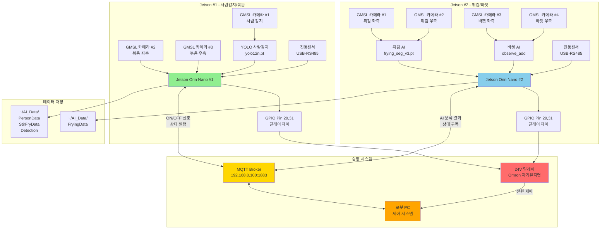
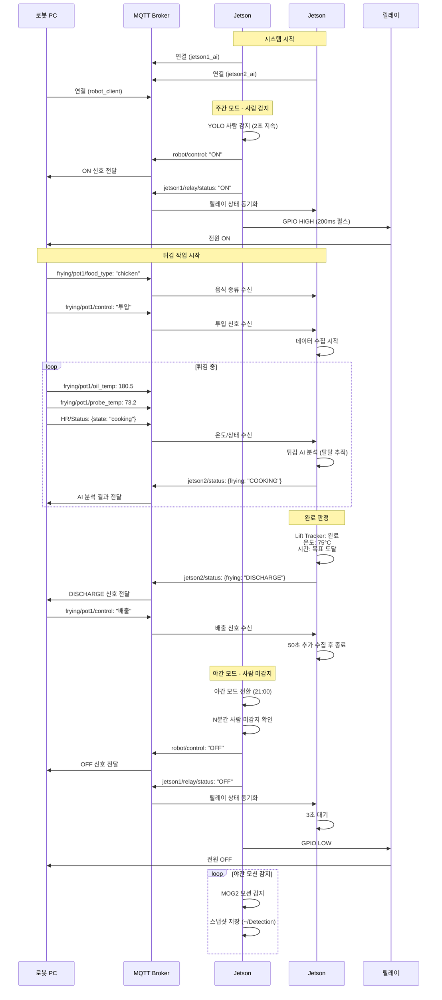
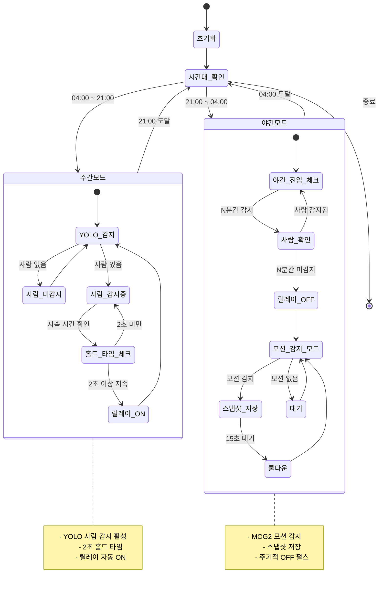
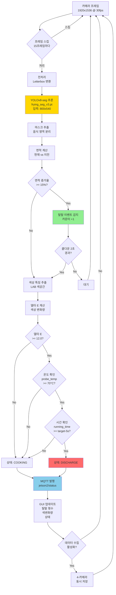
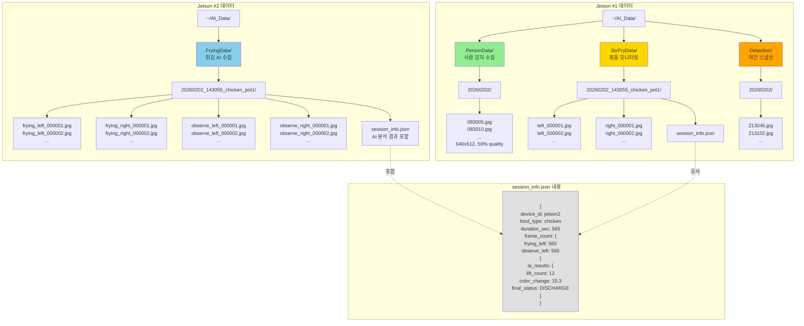
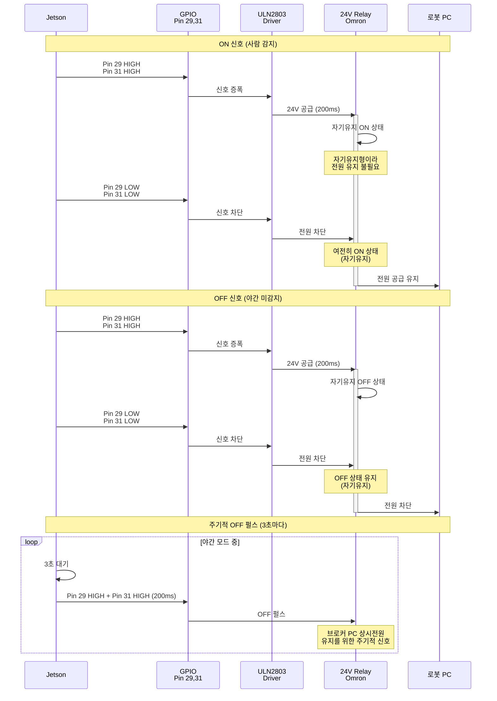
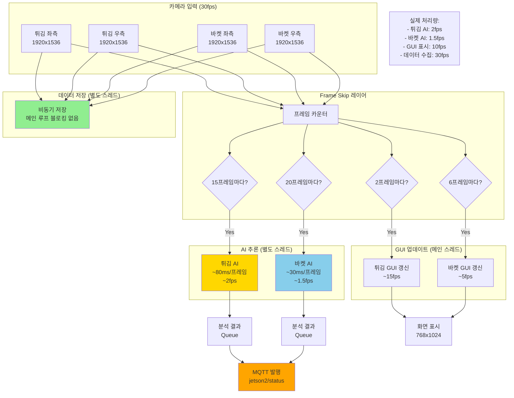

# 시스템 다이어그램 모음

본 문서는 Jetson Food AI 시스템의 주요 다이어그램을 포함합니다.

---

## 1. 전체 시스템 아키텍처



---

## 2. MQTT 통신 플로우



---

## 3. 주야간 모드 상태 머신 (Jetson #1)



---

## 4. 튀김 AI 처리 파이프라인 (Jetson #2)



---

## 5. 데이터 저장 구조



---

## 6. 릴레이 제어 시퀀스 (24V Omron 자기유지형)



---

## 7. 진동센서 측정 플로우

```mermaid
graph TB
    START[로봇 PC] --> MQTT_REQ[MQTT 발행<br/>frying/pot1/control<br/>VibrationRequest]

    MQTT_REQ --> J1_RECV[Jetson #1<br/>MQTT 수신]

    J1_RECV --> TEST_MODE{테스트 모드?<br/>vibration_test_mode}

    TEST_MODE -->|true| INSTANT_RESP[즉시 응답<br/>NORMAL 반환]
    TEST_MODE -->|false| MODBUS_CONN[Modbus RTU 연결<br/>/dev/ttyUSB0<br/>9600 baud]

    MODBUS_CONN --> READ_LOOP[5초간 반복 읽기<br/>가속도 센서 값]

    READ_LOOP --> CALC_VEL[속도 변환<br/>vel = acc × 0.001]

    CALC_VEL --> CALC_MAG[크기 계산<br/>vel_mag = √(x²+y²+z²)]

    CALC_MAG --> UPDATE_MAX[최대값 업데이트<br/>vel_mag_max]

    UPDATE_MAX --> TIME_CHECK{5초 경과?}
    TIME_CHECK -->|No| READ_LOOP
    TIME_CHECK -->|Yes| THRESHOLD_CHECK{vel_mag_max<br/>>= threshold?}

    THRESHOLD_CHECK -->|Yes| ABNORMAL[상태: ABNORMAL]
    THRESHOLD_CHECK -->|No| NORMAL[상태: NORMAL]

    INSTANT_RESP --> MQTT_RESP[MQTT 발행<br/>응답 메시지]
    ABNORMAL --> MQTT_RESP
    NORMAL --> MQTT_RESP

    MQTT_RESP --> ROBOT_RECV[로봇 PC<br/>응답 수신]

    ROBOT_RECV --> DECISION{진동 상태}
    DECISION -->|NORMAL| PROCEED[작업 계속]
    DECISION -->|ABNORMAL| ALERT[경고 알림<br/>작업 중단]

    style TEST_MODE fill:#FFD700
    style ABNORMAL fill:#FF6B6B
    style NORMAL fill:#90EE90
    style MQTT_REQ fill:#87CEEB
    style MQTT_RESP fill:#87CEEB
```

---

## 8. 성능 최적화 구조



---

## 9. 사람 감지 데이터 수집 스케줄

```mermaid
gantt
    title 사람 감지 데이터 수집 스케줄 (평일 자동 동작)
    dateFormat HH:mm
    axisFormat %H:%M

    section 야간 모드
    야간 감시 (모션 스냅샷)    :done, night1, 00:00, 04:00

    section 주간 전환
    주간 모드 시작              :crit, daystart, 04:00, 08:30

    section 데이터 수집
    사람 감지 수집 활성화       :active, collection, 08:30, 12:00

    section 일반 모니터링
    일반 사람 감지 (릴레이 제어) :done, normal, 12:00, 21:00

    section 야간 전환
    야간 모드 전환              :crit, nightstart, 21:00, 21:05
    야간 감시 (모션 스냅샷)    :done, night2, 21:05, 24:00
```



---

## 다이어그램 사용 방법

### GitHub에서 보기
- 위 다이어그램은 Mermaid 형식으로 작성되었습니다
- GitHub, GitLab, VS Code (Markdown Preview Enhanced) 등에서 자동 렌더링됩니다

### 이미지로 변환
```bash
# Mermaid CLI 설치
npm install -g @mermaid-js/mermaid-cli

# PNG로 변환
mmdc -i SYSTEM_DIAGRAMS.md -o diagrams.png
```

### 온라인 편집
- https://mermaid.live/ 에서 실시간 편집 및 미리보기 가능
